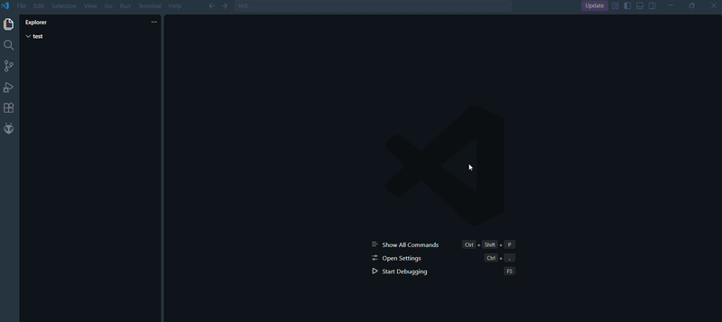
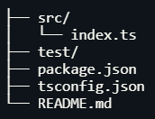
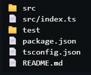
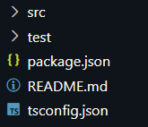

<div align="center">


# Structify

### Paste a folder tree. Get a real project. No cap. 

Turn ASCII folder trees from ChatGPT, docs, or READMEs into actual files and folders, in one click.

[](https://marketplace.visualstudio.com/items?itemName=your-publisher-id.structify)
[](https://marketplace.visualstudio.com/items?itemName=your-publisher-id.structify)
[](LICENSE)



</div>

---

## 😮‍💨 The problem

You ask an AI for a project structure. It gives you this:

```
├── packages/
│   └── physics/
│       ├── src/
│       │   ├── world.ts
│       │   └── index.ts
│       └── test/
├── apps/
│   └── client/
│       └── src/
│           └── main.ts
├── package.json
└── pnpm-workspace.yaml
```

Now you get to right-click → New File → type the name → repeat 40 times. Not it.

##  The fix

Paste the tree into Structify, check the live preview, hit **Create files**. Done. Go touch grass.

##  Features

| | |
|---|---|
|  **Paste panel** | A proper text box to drop your tree into. No clipboard guessing. |
|  **Live preview** | See exactly what will be created before anything touches your disk. |
|  **Saved templates** | Save your favourite structures and reuse them on every new project. |
|  **Built-in boilerplates** | Node + TypeScript and pnpm monorepo, ready to go. |
|  **Right-click anywhere** | Right-click any folder in the Explorer and generate inside it. |
|  **Clipboard mode** | Copy a tree, run one command, files appear. |
|  **Smart parsing** | Handles `├──`, `└──`, `│`, plain ASCII (`|--`, `+--`), 2 or 4 space indents, and trailing comments like `# entry point`. |
|  **Safe by default** | Never overwrites existing files and never writes outside your target folder. |

##  See it in action

<div align="center">

| Paste your tree | Preview it | Boom, files |
|:---:|:---:|:---:|
|  |  |  |

</div>

##  Getting started

### Install

1. Open VS Code
2. Go to Extensions (`Ctrl+Shift+X` / `Cmd+Shift+X`)
3. Search **Structify**
4. Click **Install**

Or install from the command line:

```bash
code --install-extension your-publisher-id.structify
```

### Use it

1. Open a folder in VS Code
2. Press `Ctrl+Shift+P` (`Cmd+Shift+P` on Mac)
3. Run **Structify: Open Panel**
4. Paste your tree
5. Check the preview, then click **Create files**

Prefer the Explorer? Right-click any folder and choose **Structify: Open Panel**. Files get created inside that folder.

##  Commands

| Command | What it does |
|---|---|
| `Structify: Open Panel` | Opens the paste box with preview and templates |
| `Structify: Generate from Clipboard` | Builds the structure from whatever is on your clipboard |

##  Pro tips

- **Add a trailing `/` to folders**, like `docs/`. A name with no children and no slash is treated as a file, so an empty folder needs the slash.
- **Comments are ignored.** `main.ts  # app entry` creates just `main.ts`.
- **Save your stack once.** Set up your go-to structure as a template and never type it again.
- **Existing files are skipped**, so running Structify twice is safe.

##  Roadmap

- [ ] Copy an existing folder as an ASCII tree (the reverse of Structify)
- [ ] Starter content for files in templates
- [ ] Import and export templates as JSON to share with friends
- [ ] Dry-run diff against existing folders

Got an idea? [Open an issue](https://github.com/you/structify/issues). Good ideas get built.

##  Contributing

```bash
git clone https://github.com/you/structify.git
cd structify
npm install
npm run watch
```

Then press **F5** in VS Code to launch the Extension Development Host. PRs are welcome.

##  License

[MIT](LICENSE). Use it, remix it, ship it.

---

<div align="center">

**Made with ☕ and too many `mkdir` commands.**

If Structify saved you time, drop a ⭐ on the repo and leave a review on the Marketplace. It helps a lot.

</div>
